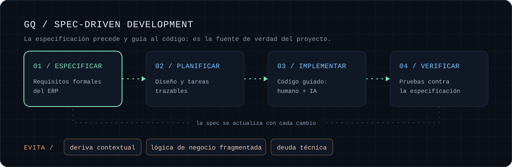

  

  <a href="mailto:gerardoxquispe15@gmail.com">Email</a> ·
  <a href="https://www.linkedin.com/in/gquispeh/">LinkedIn</a> ·
  <a href="https://openvoo.com/">OpenVoo</a> ·
  <a href="https://vger.odoo.com/">VGER ERP</a>

**Más de 9 años con el ecosistema Odoo**, desde la versión 10: soluciones ERP a medida, integraciones y automatización de procesos para empresas de distintas industrias. Hoy lidero **OpenVoo** y **VGER SOFT**, y aplico **IA** y **n8n** para que la tecnología resuelva problemas reales de negocio.

## Lo que hago hoy

<strong>Ver el detalle en texto</strong>

| Rol | Dónde | Qué hago |
|---|---|---|
| **CEO** | [OpenVoo](https://openvoo.com/) | Integrador Odoo en Perú. Dirección de la empresa y entrega de módulos Odoo Enterprise v19 a medida. |
| **Fundador** | [VGER SOFT](https://vger.odoo.com/) | ERP para Mypes sobre Odoo: facturación electrónica SUNAT preconfigurada, plantillas por rubro e implementación en 3 a 5 días. |
| **Supervisor de Transformación Digital** | PGM | Líder técnico y supervisor del área funcional en una consultora multinacional. Pilar técnico y arquitecto de soluciones con visión global en proyectos de implementación. |

## Stack

<strong>Ver el detalle en texto</strong>

- **Odoo & ERP:** módulos a medida (v10 → v19), migraciones, personalizaciones, soporte funcional y técnico, localización fiscal y facturación electrónica.
- **Backend & datos:** Python para backend y automatización, PostgreSQL para consultas complejas y optimización, API REST con testing en Postman.
- **Automatización & infraestructura:** n8n con WhatsApp API para flujos B2B, Docker y Docker Compose, GitHub Actions para CI/CD, Git y flujo colaborativo.
- **Métodos:** Scrum, Kanban y Spec-Driven Development.

## Cómo trabajo: Spec-Driven Development

> **Spec-Driven Development (SDD)** es una metodología donde una especificación detallada, formal y estructurada precede y guía la codificación, y se convierte en la «fuente de verdad» del proyecto, tanto para humanos como para asistentes de IA.
>
> Aplicada a la implementación o personalización de un ERP, SDD evita la improvisación y los problemas típicos del desarrollo asistido por IA: la deriva contextual, la fragmentación de la lógica de negocio y la alta deuda técnica.

## Trayectoria

<strong>Ver la experiencia anterior en texto</strong>

| Rol | Empresa | Enfoque |
|---|---|---|
| Desarrollador Odoo | Transgenia (Remoto) | Laboratorios y biotecnología, n8n, APIs REST |
| Desarrollador Senior Python | Indasoge SpA (Remoto) | Nómina configurable, procesos en segundo plano |
| Odoo Developer | Process Control (España, remoto) | Migración masiva SAGE ↔ Odoo vía API |
| Full Stack Odoo Developer | Big Odoo | Proyectos B2B: hoteles, mecánicas, contables, veterinarias |

## Formación y certificaciones

| Credencial | Institución |
|---|---|
| Bachiller en Ingeniería de Sistemas | Universidad Nacional de Ingeniería (UNI), Perú |
| Odoo 18 Certified Professional | Odoo |
| AI Fundamentals | IBM |
| Agile Explorer | IBM |

---

<i>“La tecnología es el puente entre los desafíos y las soluciones.”</i>

